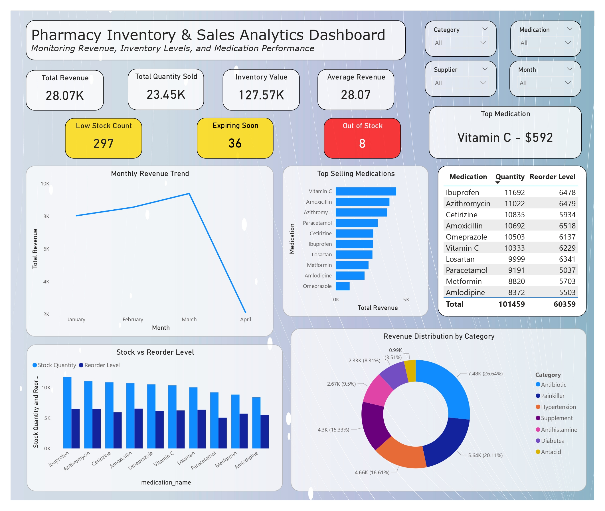

# 🏥 Pharmacy Inventory & Sales Analytics Dashboard
---

## 📸 Dashboard Preview

---
## 📌 Overview

This project analyzes pharmacy inventory and sales data to generate actionable insights using MySQL and Power BI. It focuses on tracking revenue performance, monitoring stock levels, and identifying risks such as low inventory and expiring medications.

---

## 🎯 Objectives
* Evaluate overall sales and revenue performance
* Monitor inventory levels and stock availability
* Identify medications at risk of stockout or expiration
* Build an interactive dashboard for data-driven decision-making

---

## 🛠️ Tools & Technologies
* **MySQL** – Data extraction, joins, and aggregations
* **Power BI** – Data modeling, DAX calculations, and dashboard design
* **Excel** – Data preparation and cleaning
  
---

## 🤖 Use of AI

AI tools were used to assist in:

* Created realistic synthetic healthcare dataset
* Used nested queries to calculate metrics such as returning patients
* Utilized DATE_FORMAT() to group data by month and year for time-based trend analysis
* Built logic for calculating percentage rates 
* Debugging errors in SQL and DAX
* Structuring calculations for Power BI

All outputs were manually validated and refined to ensure accuracy and reliability.

---

## 🗄️ Dataset Structure

📦 meds_data  
* medication_id  
* medication_name  
* category  
* stock_quantity  
* reorder_level  
* unit_price  
* expiry_date  

💊 sales_data  
* sale_id  
* medication_id  
* quantity_sold  
* sale_date  

---

## 📊 Key Performance Indicators (KPIs)  
* 💰 Total Revenue  
* 📦 Total Quantity Sold  
* 🧮 Inventory Value  
* ⚠️ Low Stock Count  
* 🚨 Out of Stock  
* ⏳ Expiring Soon  
* 📊 Average Revenue per Medication  
* 🥇 Top Selling Medication  

---
    
## 📈 Power BI Dashboard Features
* KPI cards for quick performance overview
* Monthly revenue trend (line chart)
* Top-selling medications (bar chart)
* Revenue distribution by category (donut chart)
* Stock vs reorder level comparison
* Low stock and out-of-stock monitoring
* Expiry tracking by month
* Interactive slicers (category, medication, date)

---
## 📊 Key Findings

**Dataset snapshot:** 1,000 medication records (10 drugs, 7 categories, 4 suppliers), 1,500 sales transactions (7 Jan – 6 Apr 2026), and a product price table. Inventory reference date is 7 Apr 2026.

| Metric | Value |
|---|---|
| Total inventory value | $127,575 |
| Units sold (≈90 days) | 23,453 |
| Sales revenue (≈90 days) | $28,068 |
| In Stock / Low Stock / Out of Stock | 703 / 289 / 8 |
| Items expiring within 30 days | 3 |
| Items expiring within 90 days | 185 (≈ $22,764 of stock) |

- **Stock-outs are a bigger risk than expiry.** 29.7% of SKUs sit below their reorder level (289 low, 8 out of stock), whereas only 3 items are within 30 days of expiry.
- **Fast movers are the most exposed.** Of the 100 SKUs with sales history, 33 are already at or below reorder level. 18 have less than 14 days of stock cover at their recent sales rate, and 5 have under a week. The most critical are M048 (Azithromycin, about 0.6 days of cover) and M033 (Amoxicillin, about 1.2 days).
- **Demand is growing.** Monthly units sold rose from 6,657 (Jan) to 7,075 (Feb) to 7,923 (Mar), about +19% over two months. April has only 6 days of data and is excluded from the trend.
- **Antibiotics and Painkillers lead.** Antibiotics generate the most revenue ($7,476, 26.6%), followed by Painkillers ($5,644) and Hypertension drugs ($4,661). Vitamin C is the top single product at $4,304. Antacids (Omeprazole) are the weakest seller.
- **Capital is tied up in slow stock.** 204 SKUs hold more than 3× their reorder level (≈ $41K), and 167 SKUs that expire within 90 days have no recorded sales.
- **Suppliers perform similarly.** Low-stock rates range from 25.9% (PharmaPlus) to 33.2% (MedSupply Co), so there is no single failing supplier. The gap is small enough that reorder discipline matters more than supplier choice.
- **Pricing table is consistent.** `mysql_price` is the `unit_price` rounded to the nearest whole dollar for all 1,000 products. This is fine for reference, but it should not be used for revenue calculations because it distorts values by up to $0.50 per unit.

## ✅ Recommendations

1. **Reorder fast-moving, low-cover items immediately.** Prioritise the 18 SKUs with under 14 days of cover (starting with M048, M033, M084, M040 and M095) and the 8 out-of-stock items (M277, M374, M396, M657, M697, M783, M888, M980).
2. **Switch from fixed reorder levels to demand-based ones.** Set reorder points as *average daily sales × supplier lead time + safety stock*. Currently 14 SKUs show "In Stock" but have less than 30 days of cover, so a static threshold hides real risk.
3. **Prioritise antibiotics and painkillers when ordering.** They are the highest-revenue categories and, for antibiotics, a stock-out has a clinical impact as well as a financial one.
4. **Apply FEFO (First Expired, First Out) and clearance rules.** Rotate the 185 items expiring within 90 days to the front, and flag any SKU whose days of cover exceeds its days to expiry (3 such fast-selling SKUs: M062, M079, M082). Consider supplier returns or discounts for expiring stock with no sales.
5. **Stop over-ordering slow movers.** Review purchasing for the 204 overstocked SKUs (>3× reorder level) and rebalance towards items that are actually selling.
6. **Add a lightweight alert system.** Trigger alerts at "cover < 14 days" and "expiry < 90 days" rather than waiting for the current "Low Stock" and "Expiring Soon" (30-day) flags.
7. **Use `unit_price`, not `mysql_price`, in calculations.** Store prices as `DECIMAL(10,2)` in MySQL to avoid rounding errors in revenue and inventory-value reporting.
8. **Extend the sales data capture.** See the limitations below.

## 🏁 Conclusion

The inventory is healthy on paper (97.7% of SKUs are within a safe expiry window and 70% are fully stocked), but the data points to an imbalance: **too little stock where demand is highest and too much where demand is zero.** About 30% of SKUs are below reorder level while roughly $41K sits in overstocked items, and demand is trending up month over month. Moving to demand-based reorder points, prioritising high-selling categories, and applying FEFO to near-expiry stock would reduce stock-outs, free up working capital, and cut expiry waste.

### ⚠️ Limitations

- **Sales cover only 100 of the 1,000 SKUs** (M001–M100). The other 900 show no sales, so "no sales" may mean missing data rather than no demand. Recommendations about slow movers and overstock should be validated against complete sales records.
- **The sales window is short (~3 months)** and April is partial, so seasonality can't be assessed and the growth trend is indicative only.
- **Current stock is a single snapshot.** Days of cover assume the recent sales rate continues and that no restocking occurred during the period.
- **Reorder levels and supplier lead times are not available as time series**, so safety stock and reorder timing are estimates.
- **The dataset appears synthetic or uniformly distributed** (e.g., prices between $0.50 and $2.00, evenly spread suppliers), so real-world patterns may differ.
---

## 🧠 Key Insights
* A small group of medications drives the majority of total revenue
* Several medications frequently fall below reorder levels, indicating supply risk
* Some inventory is nearing expiration, increasing the risk of wastage

## 🚀 Future Improvements
* Add demand forecasting  
* Implement automated refresh  
* Add drill-through and tooltips  

## 👤 Author

Adriane Clark Ballesteros  
Healthcare Data Analyst Trainee

* 🔗 GitHub: https://github.com/acbshields12

---
